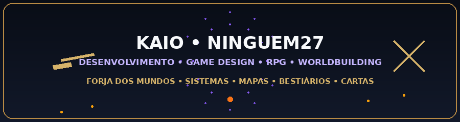

# Kaio Lucas Finizola de Oliveira da Costa
### Desenvolvedor Full Stack · Graduando em Análise e Desenvolvimento de Sistemas

Tramandaí, RS · Interesse em oportunidades remotas e estágio em tecnologia

[Conheça meu portfólio](https://github.com/Ninguem27/Portfolio-Profissional) · [Contato por e-mail](mailto:matachancho02@gmail.com)

## Sobre mim

Desenvolvo sites e aplicações web, trabalhando desde a interface até a integração de dados e a preparação para hospedagem. Meus projetos incluem uma plataforma de RPG, um sistema imobiliário e sites de apresentação comercial e profissional.

Sou responsável pelo desenvolvimento dos projetos apresentados e conto com uma pessoa no apoio aos testes. Busco minha primeira oportunidade formal na área de tecnologia para contribuir com projetos reais e continuar evoluindo em equipe.

## Projetos em destaque

| Projeto | Problema atendido | Apresentação |
| --- | --- | --- |
| **Forja dos Mundos** | Reunir ferramentas para jogadores e mestres de RPG | [Ver projeto](https://github.com/Ninguem27/Portfolio-Profissional/blob/main/projetos/forja-dos-mundos.md) |
| **Reginaldo Lopes Imóveis** | Apresentar imóveis e organizar a gestão no painel administrativo | [Ver projeto](https://github.com/Ninguem27/Portfolio-Profissional/blob/main/projetos/reginaldo-lopes-imoveis.md) |
| **Tati Finizola Creator** | Apresentar cursos, comunidade, workshops e serviços | [Ver projeto](https://github.com/Ninguem27/Portfolio-Profissional/blob/main/projetos/landing-page-tati.md) |
| **Catherini Rebelo** | Apresentar atuação profissional e facilitar o contato | [Ver projeto](https://github.com/Ninguem27/Portfolio-Profissional/blob/main/projetos/catherini-rebelo.md) |

## Conhecimentos aplicados

- **Interfaces web:** HTML, CSS, JavaScript e responsividade.
- **Desenvolvimento de sistemas:** PHP, MySQL e integração com serviços.
- **Plataforma de RPG:** Supabase, persistência de dados e recursos de PWA.
- **Entrega e evolução:** Git, GitHub, documentação, revisão e preparação para hospedagem.
- **Outros estudos:** Java, Kotlin e desenvolvimento de jogos.

## Minha forma de trabalhar

Organizo as necessidades de cada projeto, implemento as funcionalidades, acompanho os testes e faço ajustes a partir do uso. Valorizo clareza na interface, documentação útil e evolução contínua.

## Contato

[Portfólio com os quatro projetos](https://github.com/Ninguem27/Portfolio-Profissional) · [matachancho02@gmail.com](mailto:matachancho02@gmail.com) · [Instagram](https://instagram.com/ninguem_27of)
